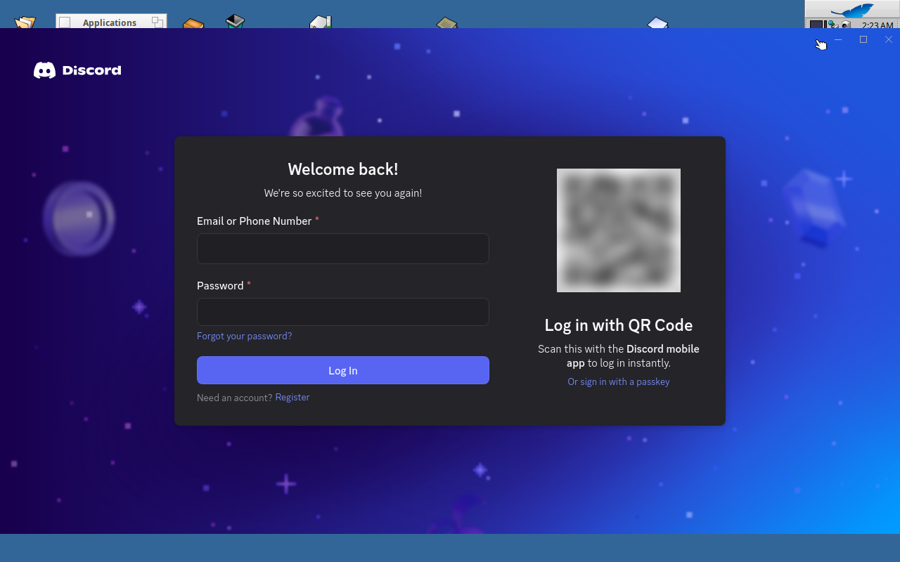
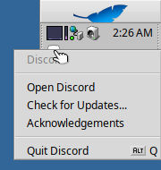

# Discord on Haiku

Discord's own desktop client runs on Aurora, unmodified, up to and including
its login screen. It gets there through its own splash screen and update
check. Its custom title bar, close-to-tray, tray menu and single-instance
relaunch all work. Nothing after signing in has been tried, because testing
needs a Discord account.



## Installing

```sh
node ports/discord/install-discord.js      # into ~/config/settings/discord
```

The installer downloads the current Linux client from Discord's distribution
service (`updates.discord.com`), the way Discord's own updater does, and checks
each package's SHA-256. It keeps these parts:

- the bootstrap app (`resources/app.asar`);
- the modules Discord's manifest requires (`discord_desktop_core`,
  `discord_utils`, `discord_voice` and others).

Linux's Electron binaries are dropped. It then makes the Haiku launcher
`app-<version>/Discord`: a copy of `aurora-host` with Discord's name, icon
and signature. It also adds a link to the launcher in Deskbar's Applications
menu. Run it again to update.

Nothing of Discord's is in this repository or in any package. The client is
downloaded on the user's machine, as it is on Linux.

## How it runs

Discord is an Electron app whose main window loads `discord.com/app`. Its
preloads give that page a `DiscordNative` bridge. Aurora runs it as Linux
Electron would, with a few settings in the launcher's `aurora.json`:

- **`AURORA_EXEC_PATH` = the launcher.** Discord's bootstrap finds its install
  folder, and decides whether its host is current, from `process.execPath`.
- **`AURORA_PLATFORM` = `linux`.** Discord's Linux code paths are the closest
  to Haiku's.
- **`AURORA_NATIVE_SHIMS` = `ports/discord/shims`.** These are JavaScript
  stand-ins for three Linux native modules:
  - `updater.node` is Discord's Rust updater. The stand-in answers its
    commands and reports the installed versions. It also installs any module
    the client asks for; on its first start the client asked for
    `discord_krisp`, `discord_zstd`, `discord_game_utils` and
    `discord_rpc`.
  - `discord_utils.node` and `notificationstate.node` answer with harmless
    values.

Every other native module fails to load. Discord treats those modules as
optional and carries on.

These features were added to Aurora for Discord. Any app can use them:

- **Node.js in preloads (remote modules).** Discord's preloads run with
  `sandbox: false` and `require()` Node modules, the updater among them.
  Those modules now live in the main process, and the page gets proxies.
  Calls, callbacks and promises all cross over.
- **`require()` into `.asar` archives.** Discord's core module is
  `require('./core.asar')`. The unpacked copy sits beside links to the
  archive's neighbours, so the module still finds its images in `../app`.
- **Frameless windows move by their `-webkit-app-region: drag` areas.**
  Double-clicking such an area maximizes or restores the window.
- **`Tray` is an icon in Deskbar's tray.** It shows the app's icon and tool
  tip, a click brings the window back, and a right-click shows the app's menu.
  The icon leaves Deskbar when the app quits or dies.
- **Smaller additions:**
  - `app.setVersion`;
  - Chromium-shaped `app.getGPUInfo` and `getGPUFeatureStatus`;
  - a fuller `buffer` module in pages;
  - `original-fs`;
  - roles, such as Quit, in menus that have no window.



In the VM, the main window is interactive 6 to 12 seconds after launch; the
splash screen takes about 4 of those.

## What does not work

- **Voice and video.** This covers calls, voice channels, screen sharing and
  noise suppression.
  - `discord_voice` and `discord_krisp` are closed-source Linux libraries.
  - Nobody but Discord can build them for Haiku.
- **Game detection** (`discord_game_utils`). It is a Linux library as well.
- **Faster gateway encodings.** `discord_erlpack` and `discord_zstd` are
  Linux libraries, so the client falls back to JSON and zlib.
- **Global shortcuts** (push to talk outside the window). `globalShortcut` is
  inert in Aurora.
- **Updates from inside the client.** The updater stand-in always reports
  "up to date", so re-run the installer instead. When Discord stops accepting
  an old client, it says so, and the installer fetches the new one.
- **A tray icon in Deskbar's colours.** Discord ships a white tray icon for
  dark Linux panels, so it is faint on Deskbar's default grey.

The client describes itself to Discord as Linux x64. Its crash reports go to
Discord's Sentry, as they would from Linux.

## Risks

This works for the same reason Slack's client would not be worth porting
(see `SLACK.md`): the app is a shell around a web client that Discord changes
server-side. Some risks follow from that:

- **Server-side changes.** Discord's web client works on Linux without the
  voice module, so it already tolerates the gaps above. But any change to
  what `DiscordNative` expects could break this port without warning.
- **Discord's terms.** They forbid modifying the client. The port runs
  Discord's files as downloaded, and adds nothing to its pages. Still, a
  different runtime underneath is not something Discord supports.
- **The alternative.** Discord supports its web client in Safari, and
  Summit's engine identifies as Safari 26. `discord.com/app` in Summit has
  not been tried.
